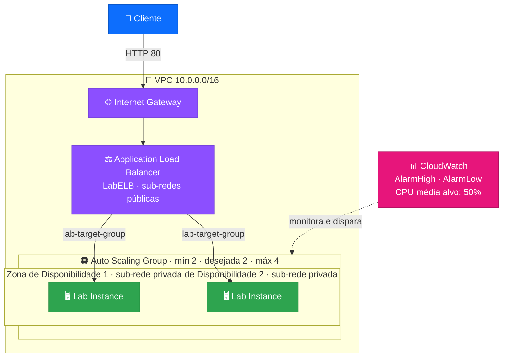
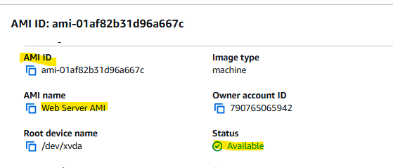
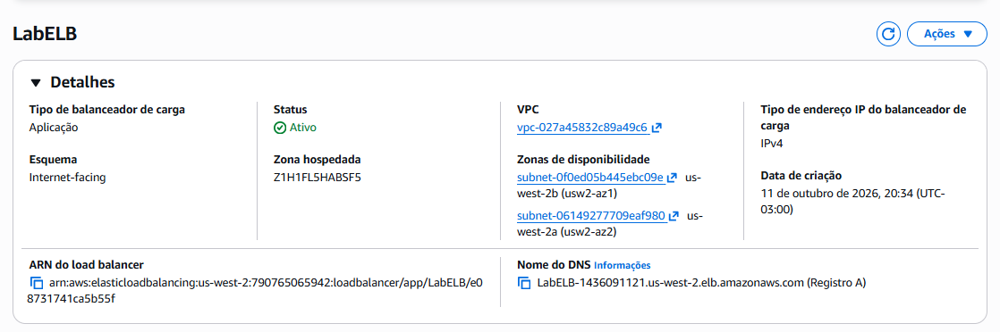
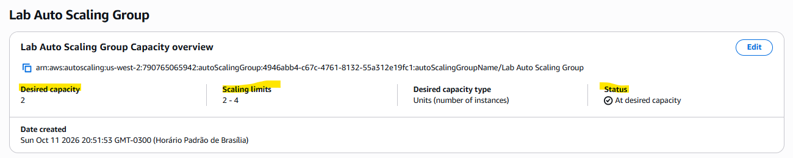
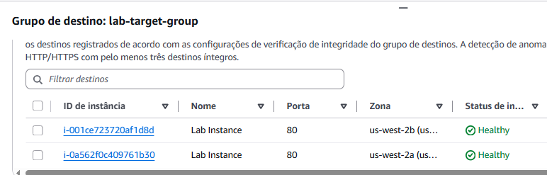
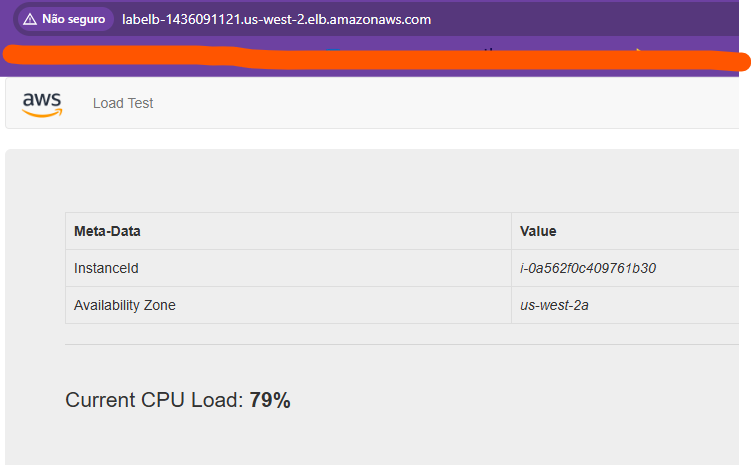
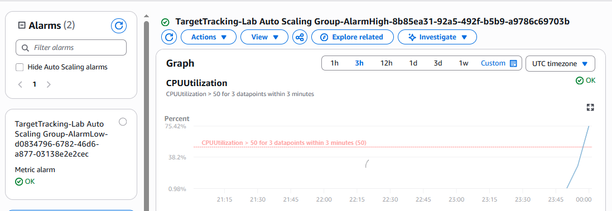
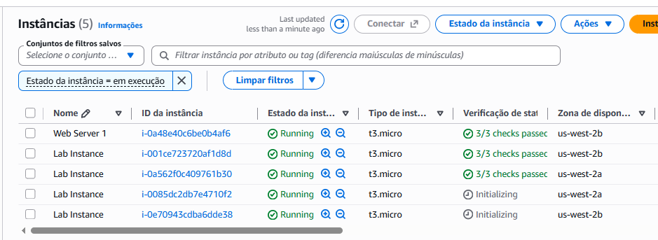
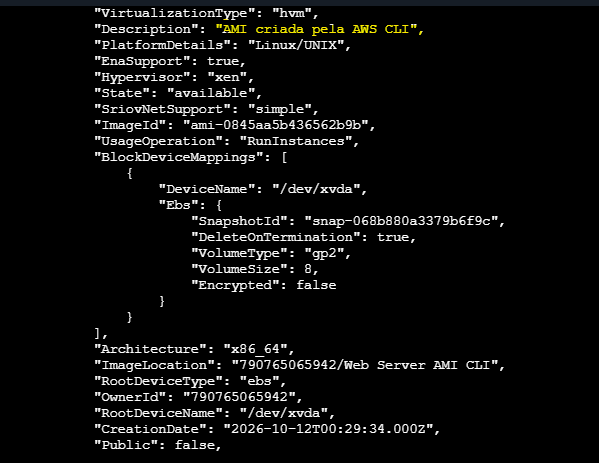

**Do servidor único à infraestrutura que balanceia carga e escala sozinha** ⚖️📈☁️

---

## 📌 Sobre o projeto

Neste laboratório, transformei uma arquitetura com **um único servidor web** em uma infraestrutura **balanceada e elástica**, usando:

- ⚖️ **Elastic Load Balancing (ELB)** para distribuir o tráfego entre várias instâncias e Zonas de Disponibilidade
- 📈 **Amazon EC2 Auto Scaling** para aumentar ou reduzir o número de instâncias conforme a demanda
- 📊 **Amazon CloudWatch** para monitorar a CPU e acionar o escalonamento automaticamente

As instâncias da aplicação ficam em **sub-redes privadas**, e somente o balanceador de carga é exposto à internet.

---

## 🎯 Objetivos

- ✅ Criar uma **AMI** a partir de uma instância EC2 existente
- ✅ Criar um **Application Load Balancer**
- ✅ Criar um **modelo de execução (Launch Template)**
- ✅ Criar um **Auto Scaling Group** com instâncias em sub-redes privadas
- ✅ Configurar uma **política de escalabilidade** baseada na CPU média (alvo de 50%)
- ✅ Gerar carga e observar os **alarmes do CloudWatch** e o aumento de instâncias
- ✅ **Desafio extra:** criar uma AMI pela **AWS CLI**

---

## 🗺️ Arquitetura final

| 🏗️ Antes | 🚀 Depois |
|---|---|
| 1 servidor web em sub-rede **pública** | 2 a 4 instâncias em sub-redes **privadas** |
| Sem tolerância a falhas | Distribuídas em **2 Zonas de Disponibilidade** |
| Capacidade fixa | Capacidade **elástica**, guiada pela CPU |
| Acesso direto ao servidor | Acesso apenas pelo **Load Balancer** |

---

## 🧰 Serviços utilizados

| 🎨 Categoria | 🔧 Serviço | 📝 Função no projeto |
|:---:|:---:|---|
| ☁️ Compute | **Amazon EC2** | Servidores da aplicação |
| 💿 Imagem | **AMI** | Cópia do Web Server 1 usada para criar novas instâncias |
| ⚖️ Rede | **Application Load Balancer** | Distribui o tráfego HTTP |
| 🎯 Rede | **Target Group** | Registra as instâncias e verifica a saúde (health check) |
| 📋 Compute | **Launch Template** | Define como cada nova instância é criada |
| 📈 Compute | **EC2 Auto Scaling** | Mantém e ajusta o número de instâncias |
| 📊 Monitoramento | **CloudWatch** | Alarmes de CPU que acionam o escalonamento |
| 🌐 Rede | **VPC, sub-redes e Internet Gateway** | Rede pública e privada em 2 Zonas de Disponibilidade |
| ⌨️ Automação | **AWS CLI** | Criação de AMI pela linha de comando |

---

## ⚙️ Configuração utilizada

| 🔹 Recurso | 🔸 Valor |
|---|---|
| **Região** | `us-west-2` (Oregon) |
| **AMI** | `Web Server AMI` (criada a partir do Web Server 1) |
| **Load Balancer** | `LabELB` · Application · Internet-facing · IPv4 |
| **Sub-redes do ALB** | Sub-rede pública 1 e Sub-rede pública 2 |
| **Target Group** | `lab-target-group` · tipo Instâncias · HTTP 80 |
| **Launch Template** | `lab-app-launch-template` |
| **Tipo de instância** | `t3.micro` |
| **Auto Scaling Group** | `Lab Auto Scaling Group` |
| **Sub-redes do ASG** | Sub-rede privada 1 e Sub-rede privada 2 |
| **Capacidade** | Mínima **2** · Desejada **2** · Máxima **4** |
| **Health check** | Tipo **ELB** |
| **Política de escalabilidade** | Rastreamento de destino · CPU média **50%** |
| **Tag das instâncias** | `Name = Lab Instance` |

---

## 🪜 Passo a passo resumido

1. 💿 Criar a **AMI** a partir do Web Server 1
2. ⚖️ Criar o **Application Load Balancer** `LabELB` nas sub-redes públicas, com o `lab-target-group`
3. 📋 Criar o **Launch Template** com a AMI, `t3.micro` e o grupo de segurança da web
4. 📈 Criar o **Auto Scaling Group** em sub-redes privadas, anexado ao Target Group, com capacidade 2 / 2 / 4 e meta de CPU de 50%
5. ✅ Verificar que as 2 instâncias ficaram **íntegras** e acessar a aplicação pelo **DNS** do balanceador
6. 🔥 Gerar carga pela aplicação **Load Test** e acompanhar o **AlarmHigh** no CloudWatch
7. 🏆 Criar uma AMI pela **AWS CLI**
8. 🧹 Encerrar o Web Server 1, que só serviu para gerar a AMI

---

## 📸 Evidências

### 1️⃣ AMI criada e disponível
A `Web Server AMI` com status **Available**, pronta para ser usada no Launch Template.

### 2️⃣ Application Load Balancer ativo
O `LabELB` com status **Ativo**, esquema **Internet-facing**, em duas Zonas de Disponibilidade e com o nome de DNS que recebe o tráfego.

### 3️⃣ Auto Scaling Group
Capacidade desejada **2**, limites de escalabilidade **2 a 4** e status **At desired capacity**.

### 4️⃣ Target Group com instâncias íntegras
As duas "Lab Instance" registradas na porta 80, em Zonas de Disponibilidade diferentes (`us-west-2a` e `us-west-2b`), ambas **Healthy**.

### 5️⃣ Aplicação respondendo pelo DNS do balanceador
A aplicação **Load Test** abrindo pelo endereço do load balancer. A página mostra o **ID da instância** e a **Zona de Disponibilidade** que atendeu a requisição, além da carga de CPU em tempo real.

### 6️⃣ Alarme do CloudWatch
O alarme **AlarmHigh**, criado automaticamente pela política de rastreamento de destino (CPU > 50% em 3 pontos de dados dentro de 3 minutos). O gráfico mostra a utilização de CPU subindo e **cruzando o limite de 50%** durante o teste de carga.

### 7️⃣ Auto Scaling em ação
Com a carga alta, o grupo passou de 2 para **4 instâncias "Lab Instance"**: duas já em execução e duas novas em **Initializing**. O Web Server 1 ainda aparece porque foi mantido para o desafio da CLI.

### 🏆 Desafio extra: AMI criada pela AWS CLI

Com o comando `aws ec2 create-image`, criei a `Web Server AMI CLI`. No console, as duas AMIs aparecem como **Available**:

E a consulta pela CLI (`describe-images`) confirma o estado `available`, a descrição "AMI criada pela AWS CLI", o volume raiz `gp2` de 8 GiB e o snapshot associado:

---

## 🐞 Dificuldades encontradas

| 🔴 Erro | 🔍 Causa | ✅ Solução |
|---|---|---|
| `Failed to create 1 Scaling policy ... service-linked role isn't available yet` | A função interna (*service-linked role*) do Auto Scaling ainda estava sendo criada na conta | Aguardar alguns minutos e criar a política de escalabilidade de novo |
| `AuthFailure` e `InvalidClientTokenId` na AWS CLI | Credenciais ou token inválidos/antigos na configuração | Limpar a configuração anterior e rodar `aws configure` com as credenciais atuais do laboratório |

> 💡 O Auto Scaling cria a função de serviço sob demanda; em contas novas, a primeira criação pode falhar por alguns instantes, e isso é esperado.

---

## 🧠 Aprendizados

- ⚖️ Um **Load Balancer** distribui o tráfego e remove automaticamente instâncias que falham no **health check**
- 🌎 Usar **duas Zonas de Disponibilidade** dá tolerância a falhas
- 🔒 Instâncias em **sub-redes privadas** não ficam expostas: só o balanceador recebe tráfego da internet
- 📈 O **Auto Scaling** mantém um número mínimo de instâncias e cresce com a demanda, sem intervenção manual
- 📊 A política de **rastreamento de destino** cria e gerencia os alarmes do **CloudWatch** sozinha
- 💿 Uma **AMI** garante que todas as instâncias novas nasçam idênticas
- ⌨️ É possível criar AMIs e outros recursos pela **AWS CLI**, o que abre caminho para automação

---

## 🔐 Observação sobre os prints

> ⚠️ Os recursos e o ID da conta que aparecem nas imagens pertencem a um **ambiente temporário de laboratório**, já encerrado. Em projetos reais, evite publicar IDs de conta, ARNs e chaves de acesso.

---

### 👩‍💻 Autora

**Luciana R B de Assis **

⭐ Se este projeto foi útil, deixe uma estrela no repositório!

